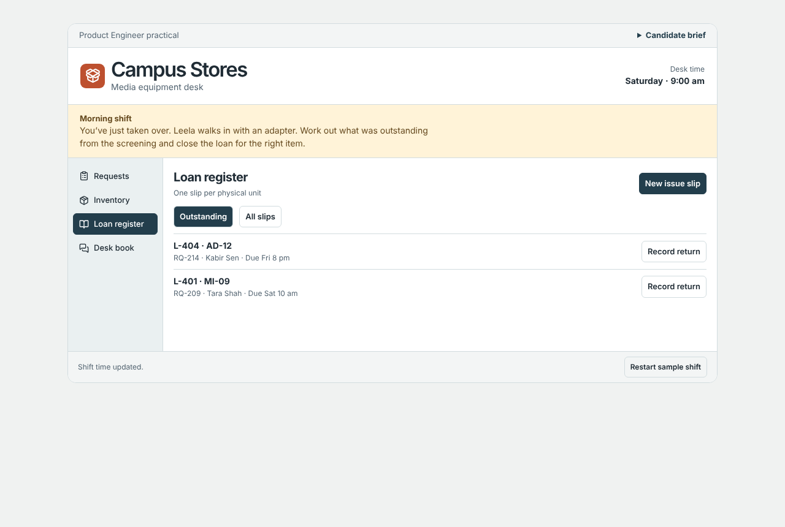
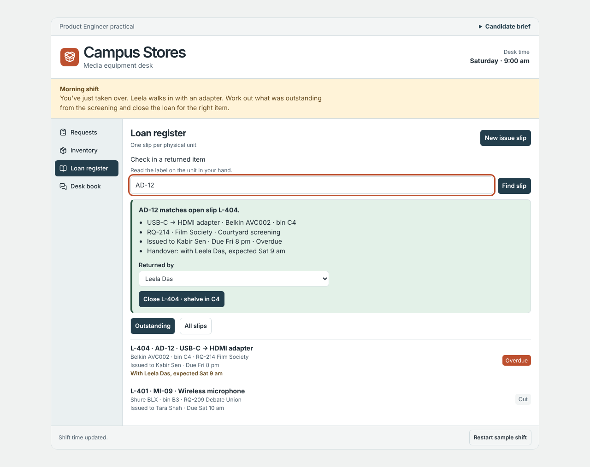
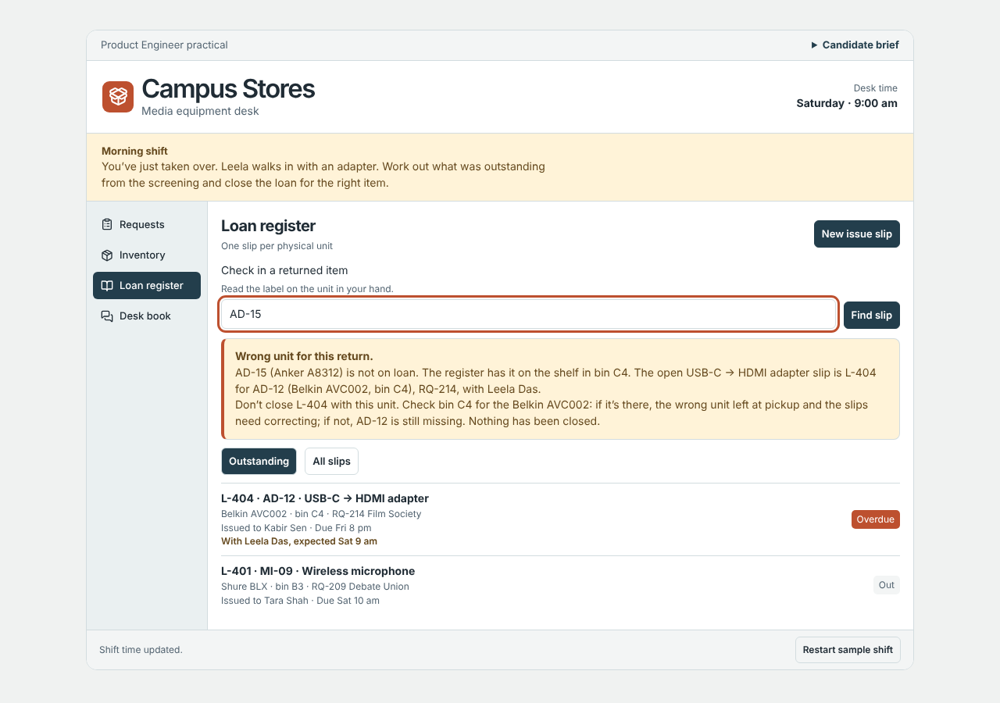
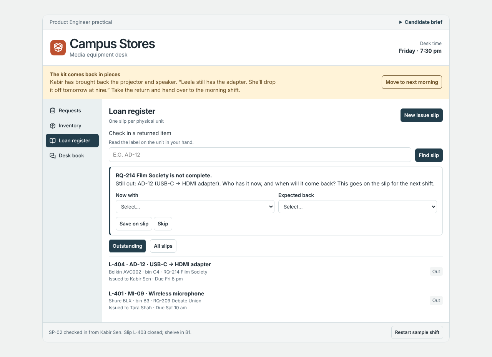

# Campus Stores

## My submission: Khushwant Meena

**TL;DR.** I'd keep one slip per physical unit. It's why the partial return works. I'd change how a loan gets closed. In the original, the morning shift clicks "Record return" on a slip and the app never checks which item is actually on the counter. I changed it so a return starts from **the label on the unit in your hand**. The app finds the matching slip, shows everything about it, and refuses the wrong unit. The code change is in `app.js` and `styles.css`, and the screenshots are in `docs/`.

### What works well: one slip per physical unit

At Fri 7:30 pm Kabir brought back the projector and the speaker. I closed L-402 (PR-04) and L-403 (SP-02), and L-404 (AD-12) stayed open by itself. The register knew exactly what was still out without anyone writing a note. Without per-unit slips, a partial return of one kit would be a mess. The issue form's guardrails also held up during my shift: it blocked the camera on RQ-214 ("outside the approved request") and a second adapter ("approved quantity already on loan").

### What I'd change: closing the loan on Saturday morning

At 9 am I had just taken over and Leela walked in with *an* adapter. The register showed only this:



`L-404 · AD-12 · RQ-214 · Kabir Sen · Due Fri 8 pm`, which tells me very little:
- It doesn't say what AD-12 is. I had to open **Inventory** to learn it's a Belkin AVC002, and that an Anker adapter (AD-15) sits in the **same bin, C4**.
- It doesn't say who has it. "Leela, 9 am" lived only in the free-text **Desk book**, so the slip still said Kabir.
- It shows no overdue flag, even though it was 13 hours past due.
- Then I clicked **Record return**, and it closed in one click with no check on the adapter in my hand. The mic's Record return button sits right below it, and nothing can be undone.

The two adapters are identical, live in one bin, and the issue dropdown showed only "AD-12 · USB-C → HDMI adapter". So the unit that physically left at 3:45 might not be the one on the slip. If Leela hands back the Anker and I close L-404, the register says the Belkin is home when it's lost. Nobody would notice until a stock check.

### The change

**Check in by label.** The register now opens with "Check in a returned item: read the label on the unit in your hand."
- **Right unit** (e.g. `ad-12`; typing `AD 12` or `ad12` also works): the app shows the slip with model, bin, request, who it was issued to, the handover and whether it's overdue. Returned by defaults to the current holder. One button: *Close L-404 · shelve in C4*.
- **Wrong unit** (`AD-15`): the app blocks it and explains which slip is actually open and what to check next. Nothing is closed.
- **Unknown label**: the app says so. Nothing is closed.

| Right adapter | Wrong adapter blocked |
|---|---|
|  |  |

**Handover lives on the slip.** After a partial return the app asks who still has the rest and when it will come back, and saves the answer on the slip. Register rows now show type, model, bin, *With Leela Das, expected Sat 9 am*, and an **Overdue** badge. The issue dropdown shows model and bin too, so the right unit leaves at pickup.



### The same job with the change

1. **Fri 3:45.** Issue PR-04, SP-02 and AD-12 to Kabir. The dropdown now reads "AD-12 · USB-C → HDMI adapter · Belkin AVC002 · bin C4".
2. **Fri 7:30.** Type `PR-04`, close it, then type `SP-02`, close it. The app says *RQ-214 is not complete, still out: AD-12*. I pick Leela Das, Sat 9 am, and save it on the slip.
3. **Sat 9:00.** The register shows `L-404 · AD-12 · Belkin AVC002 · bin C4 · With Leela Das, expected Sat 9 am · Overdue`. Leela hands over an adapter and I type its label. If it's AD-12, I close the slip and shelve it in C4, recorded as returned by Leela. If it's AD-15, the app blocks it and I check bin C4.


### What I kept

One slip per unit, the issue form and all its guardrails, the Desk book (still useful for free-form messages), and the same plain-JS, offline, no-dependency setup. Saved data moved to `campus-stores.shift.v2`. Old v1 data is ignored safely and you get a fresh shift, which I tested.

### One observation at a real counter

At the weekly shelf check, count **mismatches between what's in the bins and what the register says**, for example the register says AD-12 is in C4 but the Anker is there. Before this change, a wrong close stays invisible until that check. If the change works, that count should drop to zero. As a quicker signal, I'd watch whether the morning person closes the slip **without opening Inventory or the Desk book**.

### Trade-offs and what's next

- Typing a label is slower than one click, by a few seconds per item. At a real desk I'd add barcode or QR labels so it becomes a scan.
- If the wrong unit really did leave at pickup, the app explains the problem but doesn't fix the slips. Correcting them should be a supervisor action with a log, which I left out.
- Next on my list: issuing the whole kit in one step with a "kit complete" check at pickup. Nothing currently warns you that the USB-C laptop will be useless without the adapter.

### How I used AI tools

I used Claude to read the code, play the shift in headless Chrome, draft the change and write this up. I checked the result by replaying the whole shift on the new version: right adapter, wrong adapter (AD-15), an unknown label, reload, restart, old v1 saved data and a 390 px mobile width. All passed with no console errors. The screenshots in `docs/` come from those runs.

---

Campus Stores is a Product Engineer work sample set at a fictional campus media equipment desk. Work through a club’s screening, from equipment pickup to a partial return and the next morning’s handover. Open **Candidate brief** in the app for the assignment.

## Run the app

Open `index.html` in a modern browser. The app includes its scripts, styles, and icons and can run offline.

To serve it over local HTTP, run this from the repository folder and visit `http://localhost:8000`.

```sh
python3 -m http.server 8000 --bind 127.0.0.1
```

Each browser stores its own sample shift locally when browser storage is available. **Restart sample shift** restores the fictional starting records.

## Source

- `index.html` contains the desk layout, candidate brief, and bundled icons.
- `app.js` contains the sample records and interactions.
- `styles.css` defines the desktop and mobile layouts.

Icon license notices are in [third-party/lucide-LICENSE.txt](third-party/lucide-LICENSE.txt).


## Submit your work

1. [Fork Campus Stores](https://github.com/virinchi-healthcare/campus-stores/fork) into your GitHub account. Complete the candidate brief and push your changes to your public fork. In your README, point reviewers to your work and explain the decision you made.
2. In your fork, open **Commits**, select the final commit you want reviewed, and copy the page URL. It should look like `https://github.com/YOUR-USERNAME/campus-stores/commit/COMMIT-SHA`.
3. [Submit your work through the Google Form](https://docs.google.com/forms/d/e/1FAIpQLScvzoh1R4WS-SkiwAVBQbMvniieJYSoOEfLMyVo5CyjOvYUgQ/viewform). Your **roll number**, **email ID**, and **final commit link from your public fork** are required. Enter your roll number and email ID in the form only.
