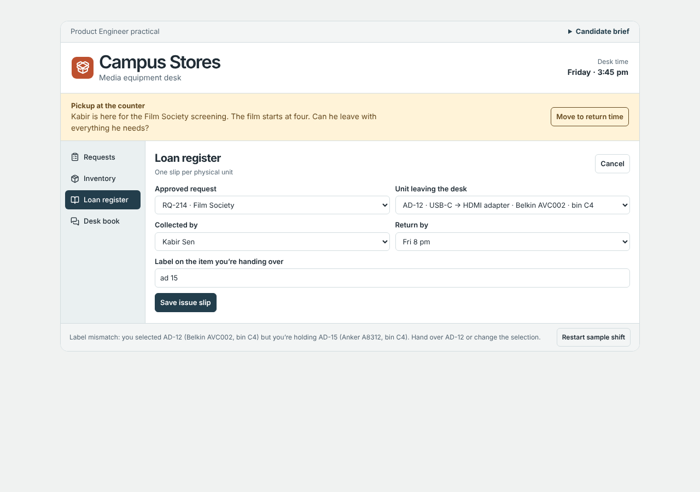
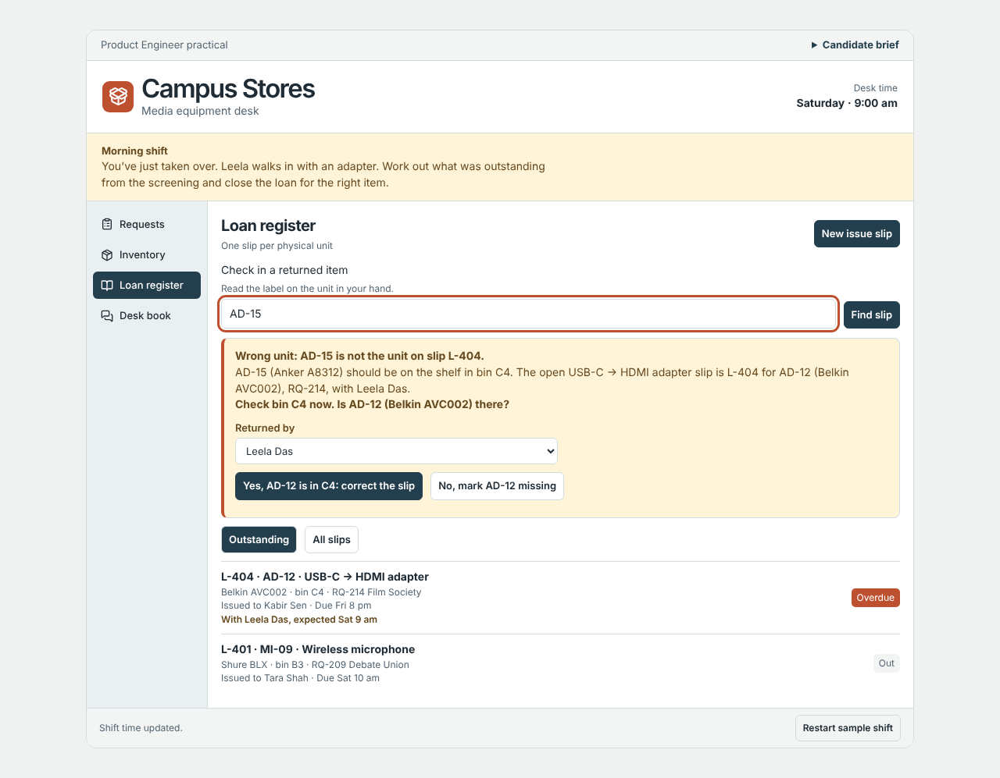
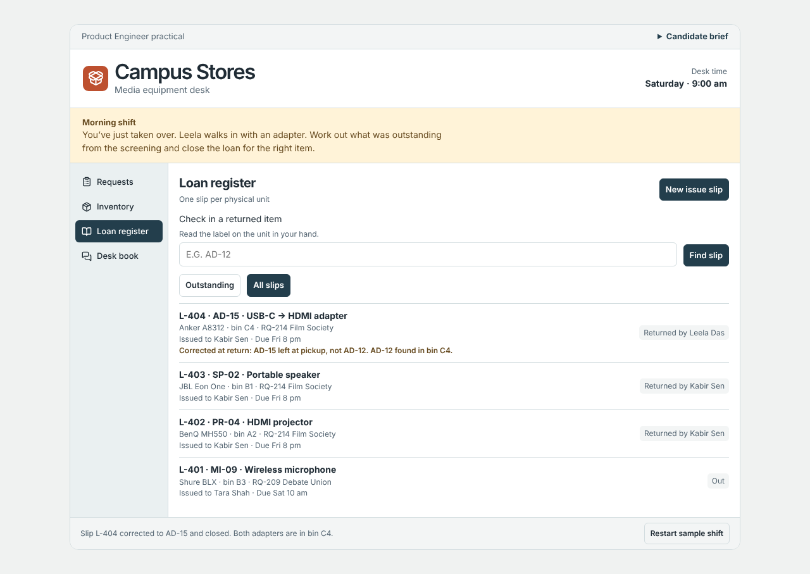
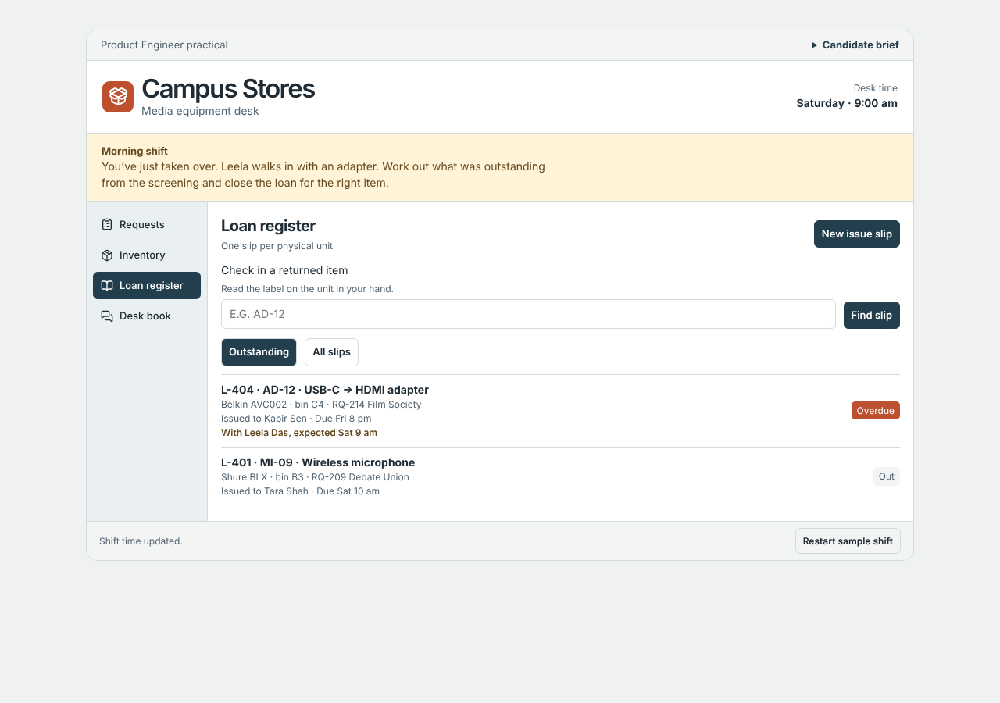

# Campus Stores

## My submission: Khushwant Meena

**TL;DR.** I'd keep one slip per physical unit. It's why the partial return works. I'd change how the app ties a slip to the actual item. In the original, nothing checks which item leaves the desk or which one comes back. The fix is one idea: **every item is checked by its label when it leaves and when it comes back, and if the two ever disagree, the app helps you fix the record.** The code change is in `app.js` and `styles.css`, and the screenshots are in `docs/`.

### What works well: one slip per physical unit

At Fri 7:30 pm Kabir brought back the projector and the speaker. I closed L-402 (PR-04) and L-403 (SP-02), and L-404 (AD-12) stayed open by itself. The register knew exactly what was still out without anyone writing a note. Without per-unit slips, a partial return of one kit would be a mess. The issue form's guardrails also held up during my shift: it blocked the camera on RQ-214 ("outside the approved request") and a second adapter ("approved quantity already on loan").

### What I'd change: closing the loan on Saturday morning

At 9 am I had just taken over and Leela walked in with *an* adapter. The register showed only this:


`L-404 · AD-12 · RQ-214 · Kabir Sen · Due Fri 8 pm`, which tells me very little:
- It doesn't say what AD-12 is. I had to open **Inventory** to learn it's a Belkin AVC002, and that an Anker adapter (AD-15) sits in the **same bin, C4**.
- It doesn't say who has it. "Leela, 9 am" lived only in the free-text **Desk book**, so the slip still said Kabir.
- It shows no overdue flag, even though it was 13 hours past due.
- Then I clicked **Record return**, and it closed in one click with no check on the adapter in my hand. The mic's Record return button sits right below it, and nothing can be undone.

The two adapters are identical, live in one bin, and the issue dropdown showed only "AD-12 · USB-C → HDMI adapter". So the unit that physically left at 3:45 might not be the one on the slip. If Leela hands back the Anker and I close L-404, the register says the Belkin is home when it's lost. Nobody would notice until a stock check.

### The change: label checks at both ends

**1. At pickup.** The issue slip now asks for the label of the item you're handing over (typed or scanned; `ad12`, `AD 12` and `ad-12` all work). If you selected AD-12 but you're holding the Anker, it won't save: *"you selected AD-12 (Belkin AVC002, bin C4) but you're holding AD-15 (Anker A8312, bin C4)."* The dropdown also shows model and bin now.



**2. At return.** The register opens with "Check in a returned item: read the label on the unit in your hand."
- **Right unit:** the app shows the slip with model, bin, request, the handover and whether it's overdue. Returned by defaults to the current holder. One button: *Close L-404 · shelve in C4*.
- **Wrong unit:** a normal close is blocked. The app tells you which slip is really open and asks you to check the bin. Then:
  - **"Yes, AD-12 is in C4: correct the slip"** moves the slip to the unit that actually came back, closes it, and leaves a visible note: *"Corrected at return: AD-15 left at pickup, not AD-12. AD-12 found in bin C4."*
  - **"No, mark AD-12 missing"** keeps the slip open with a **Missing** badge and a note, so the next shift chases it.
- **Unknown label:** the app says so and closes nothing.

| Wrong unit at return | Corrected slip |
|---|---|
|  |  |

**3. The handover lives on the slip.** After a partial return the app asks who still has the rest and when it will come back, and saves the answer on the slip. Rows show type, model, bin, *With Leela Das, expected Sat 9 am*, and **Overdue** or **Missing** badges.


### The same job with the change

1. **Fri 3:45.** For each item I select the unit and type the label of what I'm handing Kabir. If I grab the Anker from C4 by mistake, the slip won't save until the label matches.
2. **Fri 7:30.** I type `PR-04` and close it, then `SP-02` and close it. The app says *RQ-214 is not complete, still out: AD-12*. I pick Leela Das, Sat 9 am, and save it on the slip.
3. **Sat 9:00.** The register shows `L-404 · AD-12 · Belkin AVC002 · bin C4 · With Leela Das, expected Sat 9 am · Overdue`. I type the label on Leela's adapter. If it's AD-12, I close the slip and shelve it in C4. If it's AD-15, I check bin C4: if the Belkin is there, I correct the slip; if not, I mark AD-12 missing.



### What I kept

One slip per unit, the issue form's guardrails (approved types, quantity, repair units hidden), the Desk book for free-form messages, and the same plain-JS, offline, no-dependency setup. Saved data moved to `campus-stores.shift.v2`. Old v1 data is ignored safely and you get a fresh shift.

### One observation at a real counter

At the weekly shelf check, count **mismatches between what's in the bins and what the register says**. Before this change a wrong unit could leave or come back silently, so that count is where the damage shows up. With labels checked at both ends, it should drop to zero, and any mismatch that does happen is already written on the slip. As a quicker signal, I'd watch whether the morning person closes the slip **without opening Inventory or the Desk book**.

### Trade-offs

- Typing a label adds a few seconds per item at pickup and at return. At a real desk I'd print barcode or QR labels so it becomes a scan.
- "Correct the slip" trusts the staffer's check of the bin. In a real system I'd log who made the correction and let a supervisor review it.

### What's next

- **Kit view:** "RQ-214: 2 of 3 back, adapter with Leela, expected 9 am" on the request itself.
- **One-form kit issue:** issue the whole kit in one go, with a "kit complete" warning (the USB-C laptop is useless without the adapter).
- **Undo and timestamps:** issue and return times on every slip, and undo for a close made by mistake.

### How I used AI tools

I used Claude to read the code, play the shift in headless Chrome, draft the change and write this up. I checked the result by replaying the whole shift in headless Chrome: the normal shift, a wrong label at pickup, a wrong adapter at return (both the "found in bin" and "missing" paths), an unknown label, reload, restart, old v1 saved data and a 390 px mobile width. All passed with no console errors. The screenshots in `docs/` come from those runs.

---

Campus Stores is a Product Engineer work sample set at a fictional campus media equipment desk. Work through a club’s screening, from equipment pickup to a partial return and the next morning’s handover. Open **Candidate brief** in the app for the assignment.

## Run the app

Open `index.html` in a modern browser. The app includes its scripts, styles, and icons and can run offline.

To serve it over local HTTP, run this from the repository folder and visit `http://localhost:8000`.

```sh
python3 -m http.server 8000 --bind 127.0.0.1
```

Each browser stores its own sample shift locally when browser storage is available. **Restart sample shift** restores the fictional starting records.

## Source

- `index.html` contains the desk layout, candidate brief, and bundled icons.
- `app.js` contains the sample records and interactions.
- `styles.css` defines the desktop and mobile layouts.

Icon license notices are in [third-party/lucide-LICENSE.txt](third-party/lucide-LICENSE.txt).


## Submit your work

1. [Fork Campus Stores](https://github.com/virinchi-healthcare/campus-stores/fork) into your GitHub account. Complete the candidate brief and push your changes to your public fork. In your README, point reviewers to your work and explain the decision you made.
2. In your fork, open **Commits**, select the final commit you want reviewed, and copy the page URL. It should look like `https://github.com/YOUR-USERNAME/campus-stores/commit/COMMIT-SHA`.
3. [Submit your work through the Google Form](https://docs.google.com/forms/d/e/1FAIpQLScvzoh1R4WS-SkiwAVBQbMvniieJYSoOEfLMyVo5CyjOvYUgQ/viewform). Your **roll number**, **email ID**, and **final commit link from your public fork** are required. Enter your roll number and email ID in the form only.
